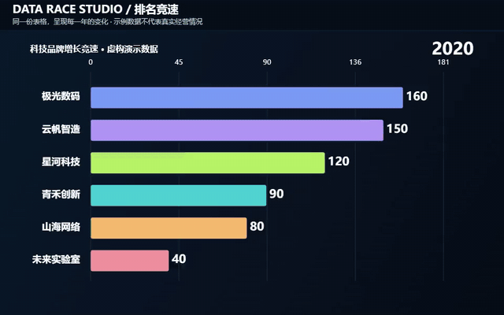

<div align="center">

# 📊 瞎折腾看数据 · Data Race Studio

### 让表格里的变化，成为看得见的故事。

导入数据 → 设计图表 → 播放竞速 → 导出视频

[🌐 在线体验](https://data.xiazheteng.fun/) · [☁️ Pages 演示](https://xiazheteng-data.pages.dev/) · [📖 部署教程](docs/DEPLOY.md) · [⚙️ API 与数据配置](docs/CONFIGURATION.md)


</div>

---

把年份、品牌、国家或业务指标整理成表格，交给浏览器制作动态排名与可分享的视频。既能做数据讲解，也能作为会议大屏、课堂演示与内容创作工具。核心图表与视频制作不需要 AI API。

## 🏁 数据竞速 · 动态演示

以虚构品牌数据展示排名变化，演示数据不代表真实经营情况。



[▶ 播放 / 下载 MP4（0.34 MB）](https://github.com/xiazheteng8/data-race-studio/raw/refs/heads/main/docs/media/demo.mp4)

> 上方为轻量循环预览；MP4 可查看完整演示。演示无音轨，避免自动播放声音。

## ✨ 一套数据，多种表达

| 模块 | 可以做什么 |
| --- | --- |
| 📥 数据导入 | CSV、XLSX、XLS；识别世界银行原始 CSV / ZIP，选择国家与年份 |
| 🏁 排名竞速 | 按时间推进的动态排名，自定义 TOP；排名收尾、庆祝与领奖台 |
| 📈 图表看板 | 条形、扇形、环形、波浪、折线与点状分布，配合主题展示 |
| 🏳️ 图标系统 | 匹配国旗、品牌标志，也能为系列上传 PNG / JPG / WebP 图标 |
| 🖥️ 大屏演示 | 查看竞速和图表；服务器与离线版本支持独立窗口，Pages 使用页内大屏 |
| 🎬 成片导出 | PNG、MP4、含可编辑原生图表的 Excel；视频支持横屏与竖屏 |
| 🎵 声音与主题 | 多套外观、网页播放器；视频背景音乐独立选择，支持上传音频 |
| 🗂️ 历史管理 | 自动保存、恢复、搜索、重命名、删除，以及 JSON 备份迁移 |
| 🤖 可选 AI | 自配 OpenAI 兼容接口或 HTTP Agent，对数据进行辅助分析 |

### 🎥 从动态排名到完整成片

- MP4 可选 **720p / 1080p / 1440p / 2160p**，默认 1080p；竖屏会交换输出宽高。
- 图标随条形和排名移动，数据名称同步显示在看板与导出标题中。
- 视频音乐与网页当前播放的音乐分开设置，短曲循环、结尾裁切。
- 编码能力取决于浏览器与设备。支持 WebCodecs 的环境可使用快速编码；4K 不代表所有电脑都能实时或同速完成。

### 🧩 缺失值也有自己的表达

空单元格表示该时间点不参与展示；重新出现时再进入排名。**`0` 是实际数值，不是缺失值。** 不会为了让画面连续，擅自把缺失年份填成零。

## 🚀 第一次使用：三分钟跑通

1. 打开 [在线体验](https://data.xiazheteng.fun/)，或下载源码后打开 `offline/index.html`。
2. 点击“导入数据”，上传表格并填写数据名称。
3. 调整 TOP、图表和图标，先预览竞速。
4. 进入视频工作室，选择分辨率、音乐与收尾方式，导出 MP4。
5. 需要长期保存时，使用历史数据与 JSON 备份；多人或跨设备使用，再配置服务器 / KV。

可先把下面的示例保存为 UTF-8 编码的 `demo.csv`：

```csv
时间,品牌A,品牌B,品牌C
2020,100,80,
2021,130,100,90
2022,180,,150
2023,240,200,210
```

第一列是时间标签，后面每列是一条系列。按文件行顺序播放，请先排好时间；至少两个周期。目前导入限制为 **5 MB、1000 个周期、30 个数值系列**，支持非负数与空白，暂不支持负数竞速。

## 🧭 选择适合你的版本

| 方式 | 打开哪个目录 | 数据保存在哪里 | 适合谁 |
| --- | --- | --- | --- |
| 本地离线 | `offline/` | 当前浏览器 IndexedDB | 自己制作视频、无需服务器 |
| VPS / NAS | `server/` | 浏览器 + 服务端 SQLite | 希望自己托管、跨设备保存 |
| GitHub Pages | 工作流发布 `offline/` | 当前浏览器；可接外部历史 API | 免费静态访问 |
| Cloudflare Pages | `cloudflare/` | 浏览器；绑定 KV 后支持云端历史 | 静态托管 + 可选云端保存 |

👉 **[完整部署教程：本地 / Docker / 反向代理 / GitHub Pages / Cloudflare Pages](docs/DEPLOY.md)**

👉 **[配置指南：历史 API、密钥、跨域、AI、数据备份](docs/CONFIGURATION.md)**

## 📦 仓库结构

```text
offline/                 本地版与 GitHub Pages 前端
server/                  Python + SQLite 服务、Docker 与 public 前端
cloudflare/              Pages 前端、_worker.js 与 KV 部署工具
.github/workflows/       GitHub Pages 自动部署
docs/                    部署与配置文档
```

## 💬 常见问题

**刷新后数据在哪里？** 同一浏览器、同一站点保存在 IndexedDB。清理网站数据或换浏览器不会自动迁移，请先导出 JSON 备份，或连接自己的历史 API。

**需要买 API 吗？** 图表、竞速与视频不需要。AI 分析是可选功能，费用、限额由所选服务商决定。

**为什么音乐没有自动响？** 浏览器通常要求先点击页面；网页音乐与视频导出音乐是两个设置。

**能把服务器版当静态文件上传吗？** 前端可打开，但 SQLite 保存需要运行 Python 后端。纯静态部署请用 `offline/` 或 `cloudflare/`。

## 🤝 反馈与支持

使用遇到问题，请到 [Issues](https://github.com/xiazheteng8/data-race-studio/issues) 附上复现步骤、浏览器版本和脱敏后的示例数据。

[📺 YouTube](https://www.youtube.com/@xiazheteng8) · [💬 Telegram](https://t.me/xiazheteng8) · [🏠 博客](https://xiazheteng.fun/)

本工具免费使用，赞赏属于自愿支持。使用品牌图标或内置音乐制作并公开发布内容时，请确认对应素材的使用授权。
